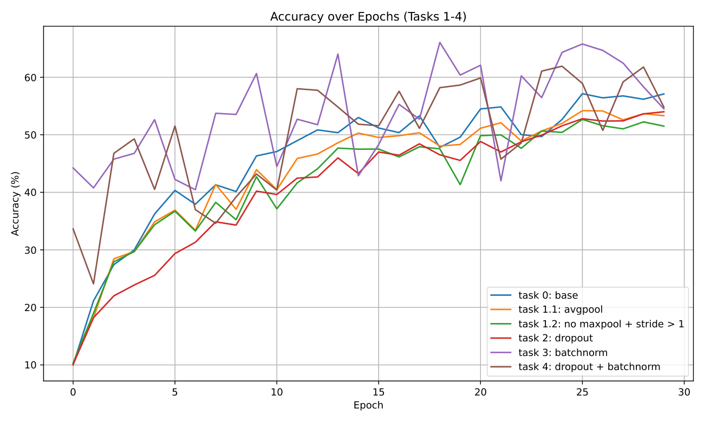
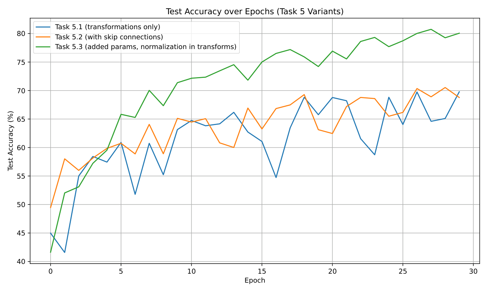

# CIFAR-10 classification (Computer Vision II, University of Bonn)

Starting from a LeNet-5 baseline in PyTorch, the notebook `cifar10_lenet_improvements.ipynb` tests the effect of average pooling, strided convolutions instead of pooling, dropout and batch normalization (tasks 1-4). Task 5 builds a compact residual CNN (under 120k parameters, 30 epochs) with data augmentation and CIFAR-10 normalization, reaching **80.74%** test accuracy (baseline: 57.15%).

- `technical_report.pdf` - results and discussion; `task_description.pdf` - assignment.
- `training_log.txt`, `plot_results.py`, `acc_loss_*.pdf` - per-epoch logs and accuracy plots.

The CIFAR-10 data is downloaded by `torchvision` and is not included.

## Report and results

[Technical report (PDF)](technical_report.pdf)

