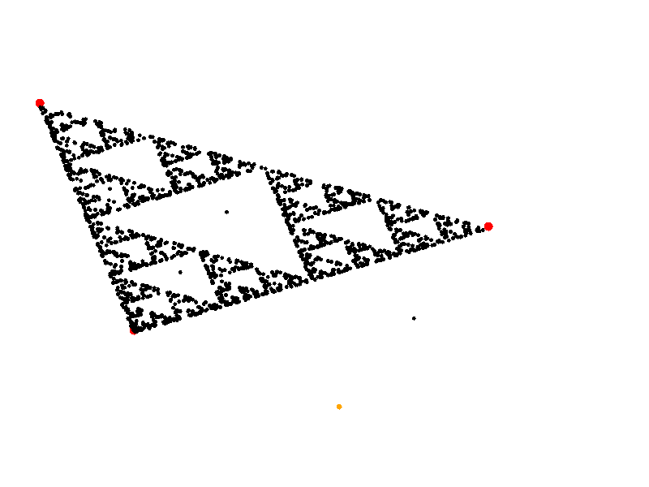

# Fractals generation

`sierpinski_triangle.py` draws the Sierpinski triangle with the "chaos game" using `turtle`: three random vertices (red) and a random start point (orange) are chosen, then 2000 times the current point moves halfway towards a randomly picked vertex and is drawn (black).

Run: `python sierpinski_triangle.py` (click the window to close it).

Example result (`result.png`):

