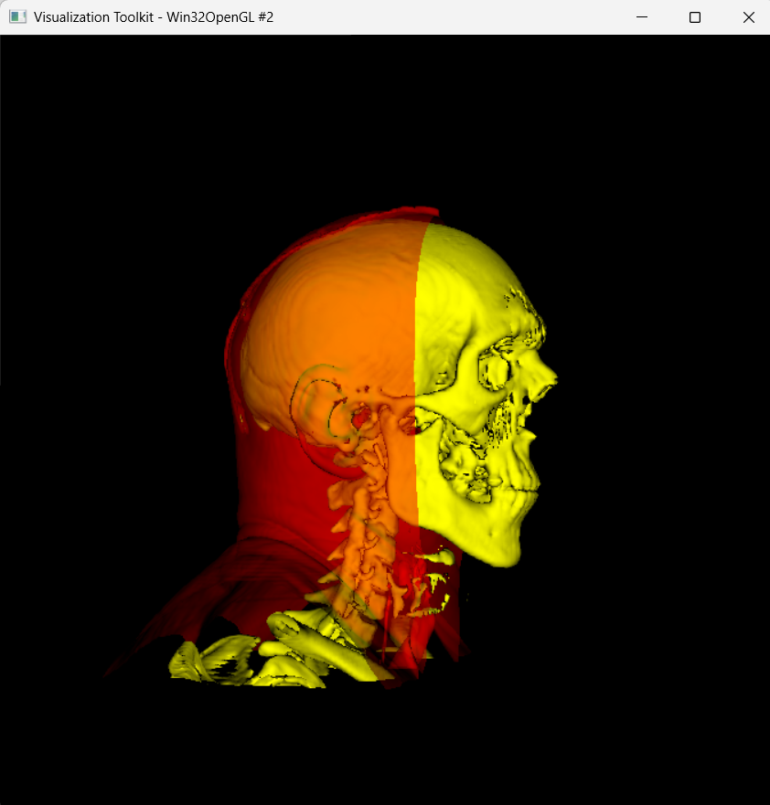
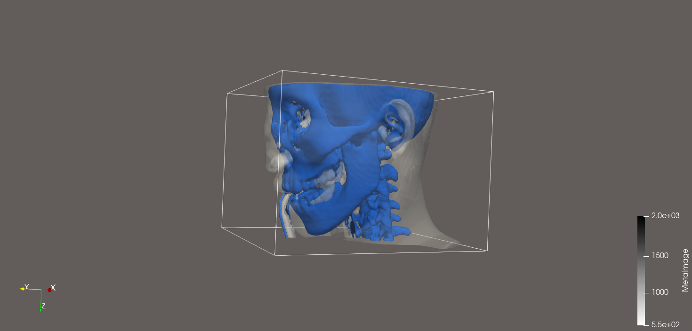
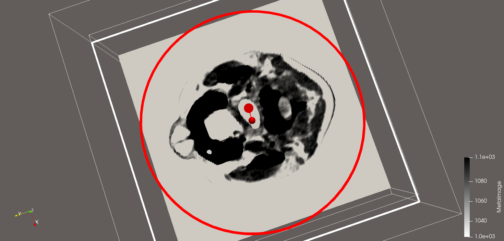
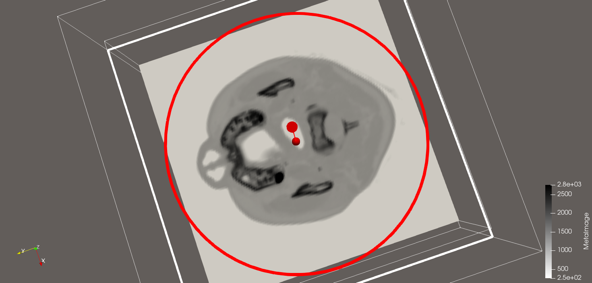
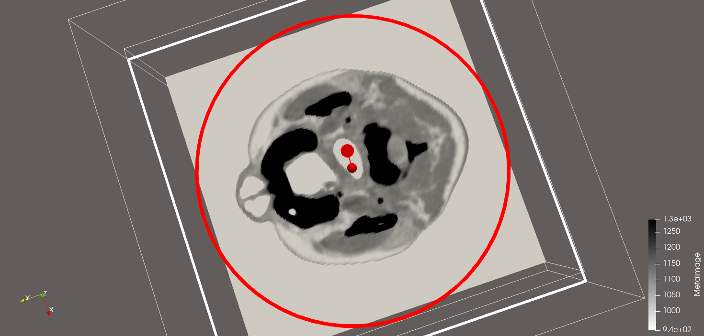

# Isosurfaces and volume visualization (Visual Data Analysis, University of Bonn)

- **ParaView:** CT head dataset (`headsq.vti`): grid type and value range, slices with three Hounsfield windows (brain / bone / blood), nested skin and bone isosurfaces. Screenshots are in `screenshots/`, ParaView states in `paraview_states/`.
- **VTK in Python** (`isosurface_framework.py`): pipeline with bounding box, bone and skin contours (`vtkContourFilter`), a clipping plane and optional camera rotation.
- **Theory** (`isosurfaces_solution.ipynb`): index-to-world transformation matrix, forward / central finite difference accuracy via Taylor expansion, bilinear interpolation and the asymptotic decider, Marching Cubes cases.

`task_description.pdf` - assignment; `solution.pdf` - exported solution. The `.vti` volumes are not included.

## Results

[Solution (PDF)](solution.pdf)

Skin and bone isosurfaces from the VTK pipeline:

Nested skin and bone isosurfaces in ParaView:

Brain, bone and blood slices with different Hounsfield windows:

| Brain | Bones | Blood |
|---|---|---|
|  |  |  |
